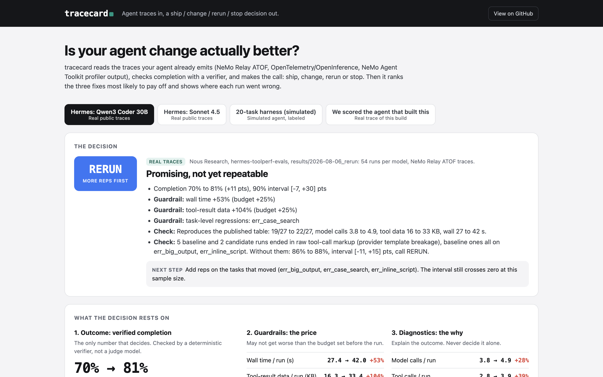

# tracecard

**Agent traces in. A ship, change, rerun or stop decision out.**

tracecard reads the traces your agent already emits, checks completion with a deterministic verifier, and tells you
whether a change to your prompt, tools or harness actually made the agent better. Then it ranks the three fixes most
likely to pay off and shows where each run went wrong.

**Live demo:** https://hassanxnawaz.github.io/tracecard/ (real public traces, no install)



## The problem

Most agent teams judge a change one of two ways: a few runs that "look better", or a single success rate. Both hide
what matters. An agent can finish more tasks while getting slower and pulling twice the data into context. Or a fix
can look like a win because of runs a provider broke.

NVIDIA put the standard plainly in its [NeMo Relay post](https://developer.nvidia.com/blog/tracing-agent-harness-behavior-with-nvidia-nemo-relay)
(Sep 30, 2026): call a candidate an improvement only when it produces a repeatable increase in task completion, or keeps
completion while improving the reliability, latency or cost measure you meant to change. tracecard turns that sentence
into a command.

## What it does

```
traces (ATOF / OpenTelemetry / NAT profiler)  ->  verifier  ->  metrics  ->  decision + top 3 fixes + trace viewer
```

Three tiers of metrics, kept apart on purpose:

| Tier | Metrics | Role |
|---|---|---|
| Outcome | verified task completion, with a task-clustered bootstrap interval | The only number that decides |
| Guardrails | wall time per run and per step, input tokens, cost, tool-result KB | May not get worse than the budget you set |
| Diagnostics | tool errors, retries, identical repeats, wrong tool, bad arguments, model calls | Explain the outcome; never decide it alone |

The decision:

- **SHIP**: the completion interval clears zero within budgets, or completion holds (within 5 pts) and the target metric improves.
- **CHANGE**: completion is up, but a guardrail is over budget or a task regressed.
- **RERUN**: promising, but the interval still crosses zero. It names the tasks to add reps on.
- **STOP**: worse, or no measurable effect. Don't claim a win.

Fix detectors (ranked by failed runs touched, then wasted steps): gives up after a tool error, identical retries,
bad arguments, wrong tool, oversized tool results, empty results that trigger blind re-searching, turn blow-ups
against the task median, and raw tool-call markup from a broken provider template.

## Case study: Hermes ToolPerf, from raw traces

Nous Research published the raw NeMo Relay traces behind the Hermes ToolPerf case study in NVIDIA's post
(108 runs: 2 models x 2 arms x 9 tasks x 3 reps). tracecard rebuilds the published table from them exactly:
Sonnet 4.5 24/27 to 23/27, Qwen3 Coder 30B 19/27 to 22/27, with matching model calls, tool calls, tool-result KB and
wall time. A test checks this.

| | Decision | Why |
|---|---|---|
| Sonnet 4.5 | **STOP** (no measurable effect) | -1 run of 27, every trace measure flat. Keep the fixes for the models they help; don't report a Sonnet win. |
| Qwen3 Coder 30B | **RERUN** | +11 pts, but the 90% interval is [-7, +30] at 3 reps; wall time +53%, tool data +104%; one task (case-insensitive search) went from 3.3 to 9.3 model calls with no completion gain. |

One thing the traces surface that a success rate can't: all 5 baseline Qwen runs that ended in raw tool-call markup
(a provider template problem the Hermes README also notes) sit on the two tasks credited as wins. Drop the broken runs
from both arms and completion goes 86% to 88%. The traces can't say whether the fixes avoided the breakage or it was
chance, so the next step is to pin the template and rerun those two tasks with more reps. That's the "repeat the
evaluation before generalizing" step NVIDIA's post recommends, applied.

```bash
sh scripts/fetch_hermes.sh                    # ~28 MB of public traces, not redistributed here
python -m tracecard compare \
  data/hermes/results/qwen_qwen3-coder-30b-a3b-instruct/baseline \
  data/hermes/results/qwen_qwen3-coder-30b-a3b-instruct/fixes \
  --verifier examples/hermes_toolperf/verifier.py:verify --html qwen.html
```

## Quickstart (offline, no keys, standard library only)

```bash
git clone https://github.com/hassanxnawaz/tracecard && cd tracecard
python -m tracecard compare runs/harness/baseline runs/harness/candidate --price-in 0.5 --price-out 1.5 --html report.html
python -m unittest discover -s tests
```

Python 3.10+. No dependencies. `pip install -e .` adds a `tracecard` command.

### Score your own traces

```bash
# NeMo Relay ATOF: one *.atof.jsonl per run, optional meta.jsonl sidecar (run_id, task, arm, rep, success or tail)
python -m tracecard score path/to/atof_dir --verifier my_checks.py:verify

# OpenTelemetry with OpenInference attributes: OTLP JSON or a Phoenix span export
python -m tracecard compare before/ after/ --target wall_s --budget-wall 0.2 --budget-cost 0.2 --md decision.md

# NeMo Agent Toolkit: nat eval output with the profiler enabled
python -m tracecard score .tmp/nat/eval/all_requests_profiler_traces.json --html nat.html
```

A verifier is any `verify(run, meta) -> bool | None`. Keep it deterministic. A judge model can be one input, but it
shouldn't be the thing that decides.

### The 20-task harness

`harness/` is a small tool-use battery: 20 tasks over 9 deterministic mock tools (weather, currency, calculator,
orders, users, docs search and read, calendar). Two configs differ only in the tool layer: `baseline` (terse
descriptions, bare errors, full results) and `candidate` (enums and examples, errors that name the next valid call,
paged results).

```bash
python -m harness --config baseline  --out runs/harness/baseline     # offline simulator
python -m harness --config candidate --out runs/harness/candidate

# Live, against any OpenAI-compatible endpoint, including NVIDIA NIM:
export NVIDIA_API_KEY=...
python -m harness --config candidate --out runs/live/candidate \
  --endpoint https://integrate.api.nvidia.com/v1 --model <model-id> --api-key-env NVIDIA_API_KEY
```

The offline runs in `runs/harness/` come from a **simulated agent**: it follows each task's reference plan and injects
failure modes at fixed rates per config. They exist so the pipeline runs anywhere and the tests are deterministic.
They say nothing about any real model. Live mode is tested against a local mock server, not against NIM, in this repo.

## How it fits NeMo Agent Toolkit and NeMo Relay

tracecard doesn't replace any of it. It sits after the tracing and before the decision:

- **NeMo Relay** captures the evidence (ATOF events, ATIF trajectories, OpenInference spans). tracecard reads ATOF
  and OpenInference directly.
- **NeMo Agent Toolkit** `nat eval` runs workflows, evaluators and the profiler. tracecard reads its intermediate
  steps (`all_requests_profiler_traces.json`, `workflow_output.json`) and adds the baseline-vs-candidate call.
- **Phoenix** (or any OTLP backend) is where you inspect one run. tracecard is where you decide about two arms.
- **NIM** endpoints work in live mode through the OpenAI-compatible API.

A natural next step would be a `nat` evaluator plugin that emits the decision inside `nat eval`.

## We scored the agent that built this

This repo was built by an AI coding agent. Its own session was exported as OpenInference spans (all content stripped:
no prompts, outputs, argument values or tool results; the model vendor name redacted) and scored like any other trace.
It's the fourth tab in the demo and lives in `examples/dogfood/`.

- One session, 14.7 minutes: 51 model calls, 54 tool calls, 7 tool errors, $4.51 provider-reported cost, 7.8M input
  tokens (mostly cached context). Verifier: the test suite passing, including the Hermes table rebuild.
- All 7 errors are real. Two were bugs the agent wrote and fixed on the next call. Five were browser calls the sandbox
  doesn't support, made before it switched to a local web server.
- Scoring this trace caught a bug in tracecard itself: with argument values redacted, every call looked identical, so
  it reported retry loops that weren't there. Fixed in the same session, with a test.
- The trace ends at the first full test pass. The README and publishing came after and are not in it.

## Limitations

- Completion is only as good as the verifier. The Hermes verifier checks two tasks from the agent's final output
  because their sandboxes aren't published (documented in `examples/hermes_toolperf/verifier.py`); the totals still
  match the published table.
- The bootstrap treats tasks as the unit. With 9 to 20 tasks and 3 reps, intervals are wide on purpose.
- Fix impact is a ranking heuristic, not a forecast.
- Token and cost numbers are used only when every model call reports usage. The Hermes traces report it on 18% to 27% of
  calls, so tool-result KB stands in there.
- Tool errors in ATOF are inferred with the same heuristic the Hermes harness uses (status, `error` key, nonzero exit code).
- ATIF trajectories aren't read yet; ATOF and OpenInference cover the same runs.

## Roadmap

1. ATIF reader and a `nat eval` evaluator plugin that writes the decision next to the other evaluator outputs.
2. Power estimate: how many reps you need to see a given completion change.
3. Per-model splits in one report, so "helps the weak model, neutral on the strong one" is one view.
4. Live NIM runs of the 20-task battery with two open models, published with their traces.
5. A CI mode that fails a pull request on STOP and comments the decision on CHANGE or RERUN.

## How this was built

Hassan Nawaz set the goal, the metrics that matter and the review bar. AI coding
agents wrote the code under his direction. He reviews and decides what ships. The agent's own build trace is scored
above, mistakes included.

## Credits

Hermes ToolPerf and its traces: Nous Research ([hermes-toolperf-evals](https://github.com/NousResearch/hermes-toolperf-evals)).
The decision rule follows NVIDIA's NeMo Relay guidance linked above. Not affiliated with or endorsed by NVIDIA or Nous Research.

Designed and directed by Hassan Nawaz. Built by AI coding agents working under his direction.
MIT licensed.
